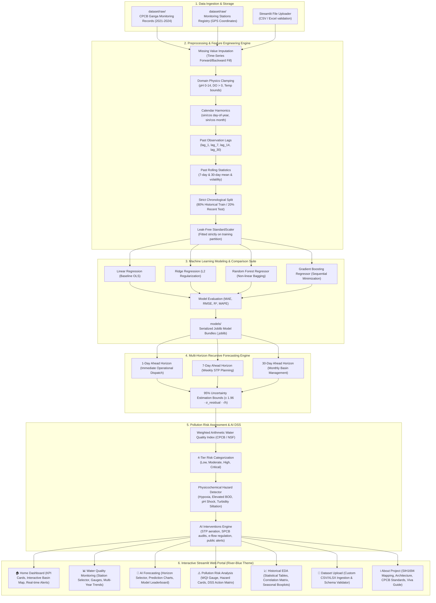
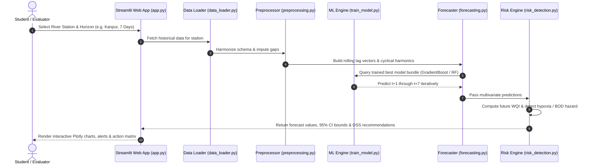

# AI Water Quality Forecasting System - System Architecture
**Project ID**: P18 | **Group ID**: OJ18  
**Mapped SIH Problem Statement**: SIH1694 – Real-time Ganga River Water Quality Forecasting using AI-enabled DSS, satellite data, IoT, and dynamic models.

---

## 1. High-Level System Architecture

---

## 2. Machine Learning Pipeline Sequence

---

## 3. Water Quality Index (WQI) Mathematical Formulation

The Water Quality Index is calculated using the standard **Weighted Arithmetic Index Method** recognized by CPCB and the National Sanitation Foundation (NSF):

$$\text{WQI} = \frac{\sum_{i=1}^{n} q_i \cdot W_i}{\sum_{i=1}^{n} W_i}$$

Where:
- $q_i$ is the quality rating or sub-index for parameter $i$:
  $$q_i = \left| \frac{V_{\text{actual}} - V_{\text{ideal}}}{S_{\text{standard}} - V_{\text{ideal}}} \right| \times 100$$
- $W_i$ is the unit weight assigned to parameter $i$ (Dissolved Oxygen: 0.35, BOD: 0.25, pH: 0.15, Turbidity: 0.10, Conductivity: 0.10, Temperature: 0.05).
- $S_{\text{standard}}$ is the CPCB permissible threshold.
- $V_{\text{ideal}}$ is the ideal benchmark value (e.g., $14.6\text{ mg/L}$ for DO, $0.0$ for BOD, $7.0$ for pH).

---

## 4. Risk Classification Tiers

| WQI Score Range | Risk Category | CPCB Water Quality Class | Permissible Uses |
| :---: | :---: | :---: | :--- |
| **0 – 35** | 🟢 **Low Risk** | Class A / B | Drinking water source (after disinfection), organized outdoor bathing |
| **36 – 65** | 🟡 **Moderate Risk** | Class C | Drinking source after conventional treatment & disinfection |
| **66 – 85** | 🟠 **High Risk** | Class D | Propagation of wildlife and fisheries only; no direct contact |
| **86 – 100+** | 🔴 **Critical Risk** | Class E & Below | Industrial cooling, controlled irrigation; severe hypoxia/pollution alert |
